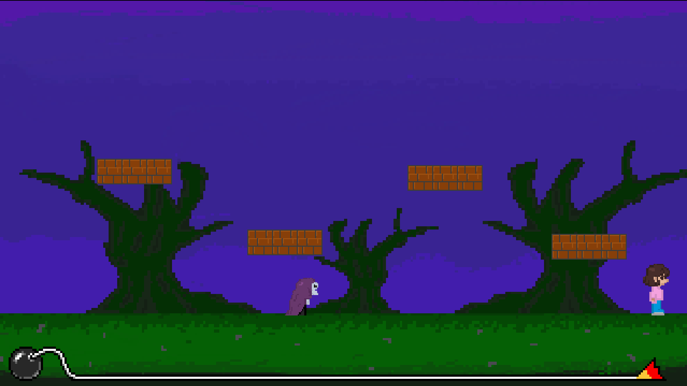
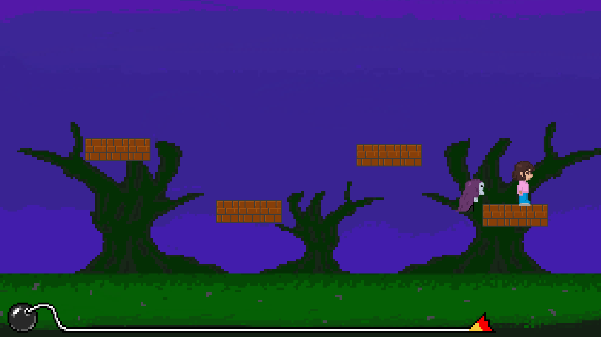
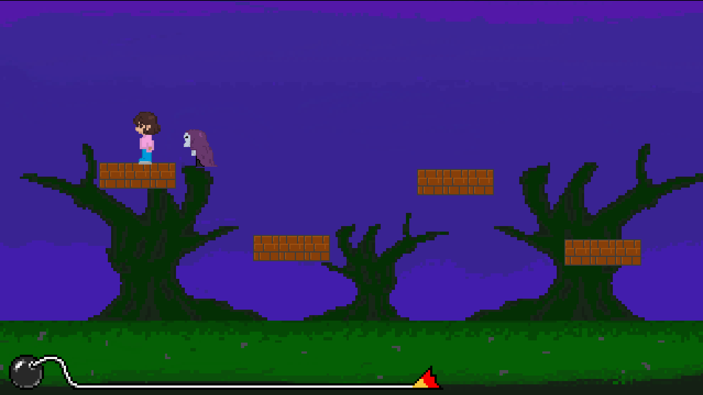
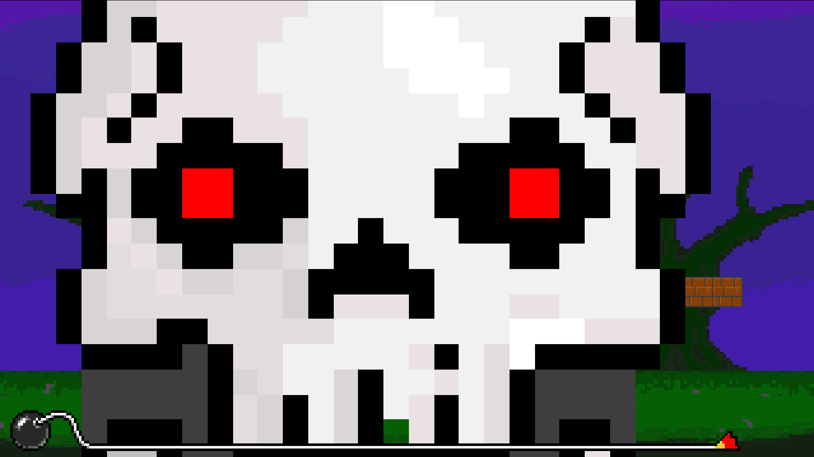

# SkeletonRun

A short horror microgame developed using Godot for a Microgame Jam.

**Game Jam:** October 26 – November 7, 2026

## 📜 Description

SkeletonRun is a short horror game where the player must avoid an AI-controlled enemy that actively chases them. The goal is to evade the enemy and avoid getting caught. If the enemy reaches the player, a jumpscare is triggered.

Designed as a bite-sized horror experience, the game focuses on creating tension through enemy pursuit and a sudden scare.

## 🖥️ Development

Developed using Godot with a minimal API. All gameplay logic was implemented independently, with the exception of the bomb timer functionality provided by the API. All game artwork was created from scratch.

## 🎮 Gameplay

### Screenshots

| Gameplay | Screenshot |
|---|---|
| Running right from the enemy |  |
| Enemy catching the player |  |
| Running left from the enemy |  |
| Jumpscare |  |

## 🔧 Future Improvements

- **Enemy AI:** Currently, the enemy uses a simple vector-based approach to follow the player's position. An improvement would be to implement obstacle detection and avoidance, allowing the enemy to navigate around obstacles rather than simply moving directly toward the player.

## 🛠️ Credits

### 🎵 Audio
- **Jumpscare Audio:** [Hello Neighbor Jumpscare](https://www.myinstants.com/en/instant/hello-neighbor-jumpscare-19906/)
- **Background Music:** "scary!.wav" by prismoid.
